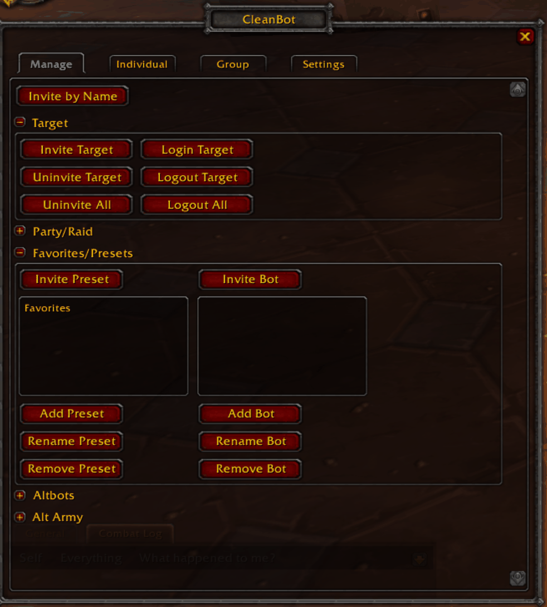
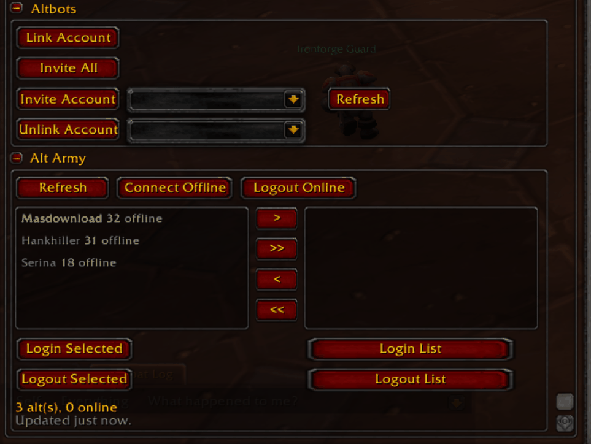
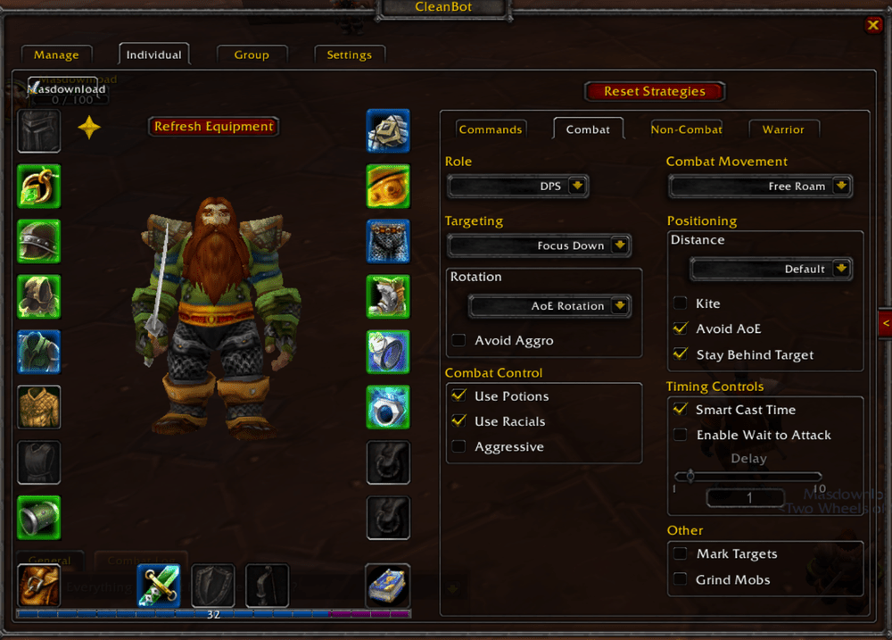
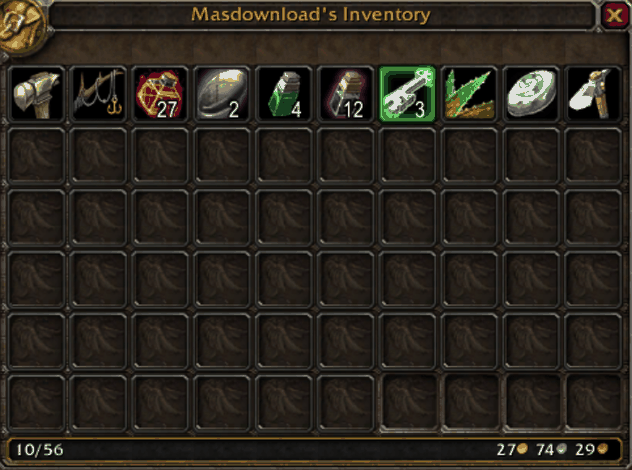
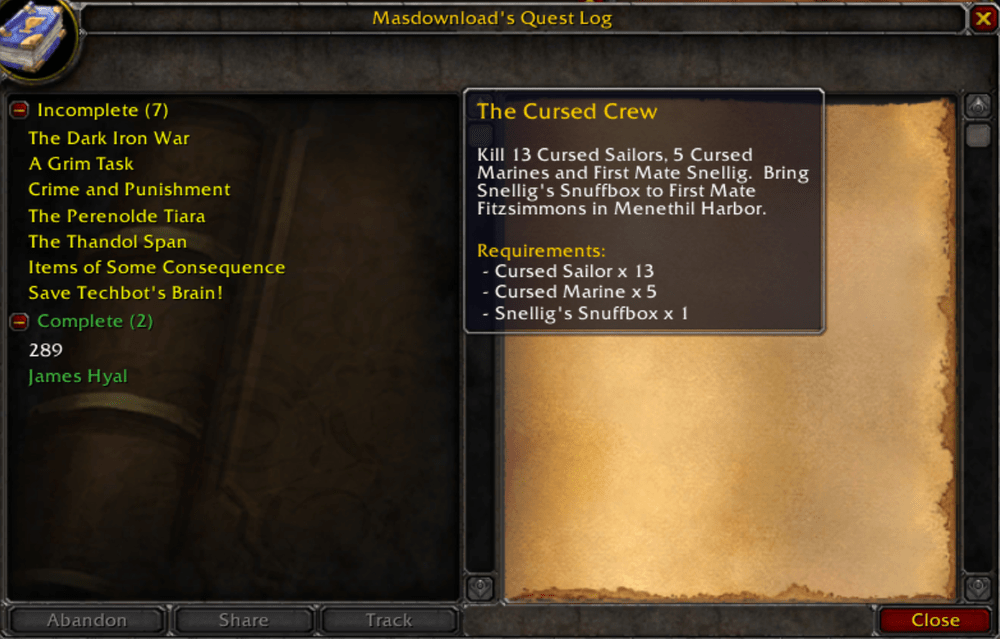
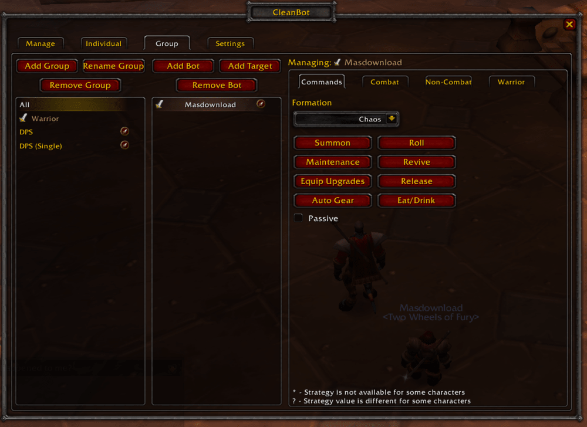
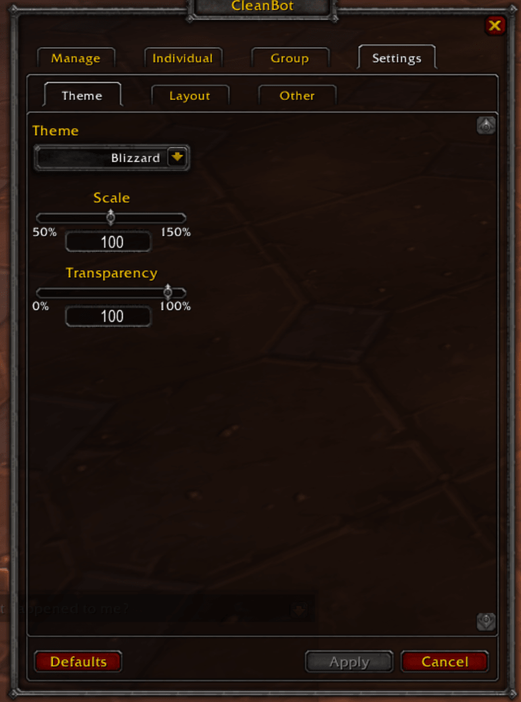
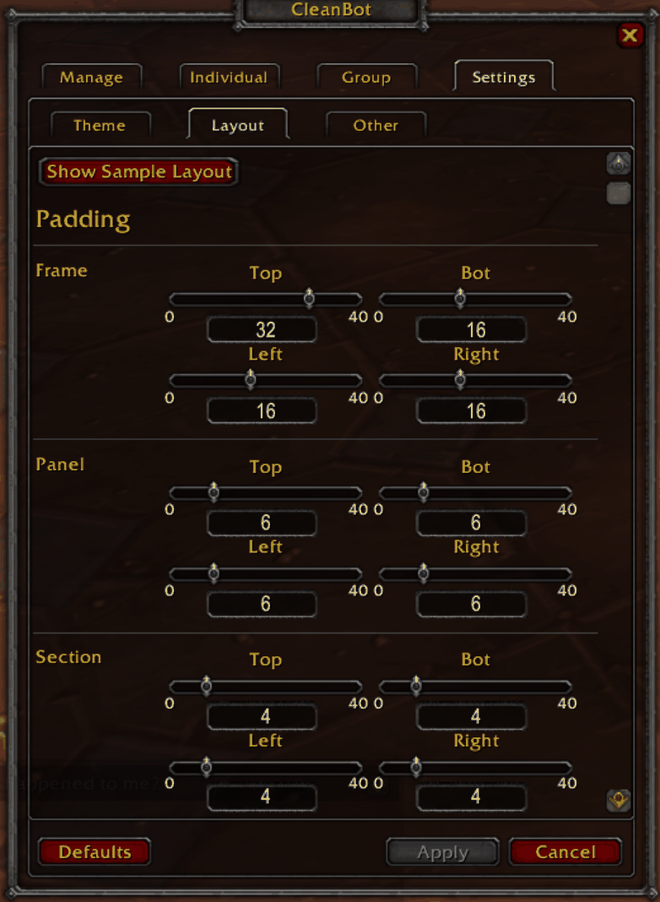
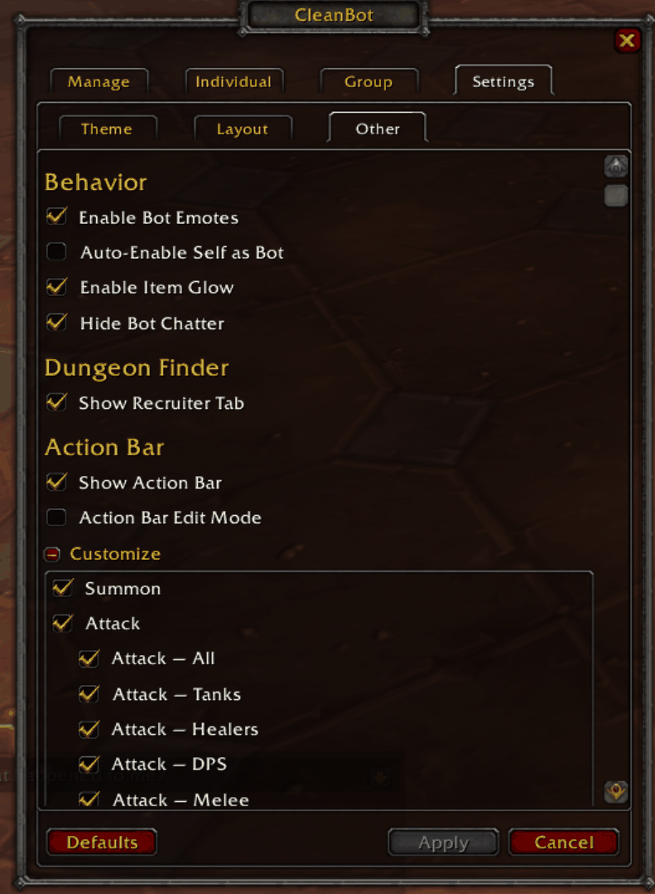

# CleanBot

A clean interface to manage Playerbots on WotLK 3.3.5a Servers. No more complex trees of buttons!

⚠️Requires the latest version of [Playerbots](https://github.com/mod-playerbots/mod-playerbots) installed on your server⚠️

- Fully Skinned for the default WoW UI or [ElvUI](https://github.com/ElvUI-WotLK/ElvUI/tree/master)
    - Choose the **Blizzard** (default) or **Flat (ElvUI)** theme in Settings
- Compatible Optional Extras:
    - [Multibot Bridge Server Module](https://github.com/Wishmaster117/mod-multibot-bridge) - Removes some of the whisper spam and speeds up query/action time
    - [Talented](https://warperia.com/addon-wotlk/talented/) - Opens the large three panel talent tree for bots

# Manage Tab
- Invite/Uninvite, Login/Logout bots
- Group Revive, Release, Eat/Drink, Maintenence, Summon
- Create Custom Presets, Invite All From Preset
- Link an Account for Altbot Usage
    - Invite Linked Account, Unlink Account
- Alt Army: log your account's alts in or out as bots, one at a time or as a list
- Fully Collapsable Sections

# Individual Tab
- Manage Individual Bots Within Your Party or Raid
- Set Combat, Non-Combat, and Class Specific Strategies
- Target Party/Raid Members to Swap to Them
- Manage gear through drag and drop or context menus
    - View Gold and Items in an intuitive and familiar interface
    - Open Bank (if nearby a banker) or Sell Grays (if near a vendor)

## Quest Log
- Check Failed, Incomplete, and Completed Quests
    - Read quest text and requirements directly for any quest you both share
- Abandon Bot Quests

# Group Tab
- Multiselect groups and bots using the standard windows shortcuts
    - CTRL + Click to add/remove selection
    - Shift + Click for range selection
- Add groups, rename them,
- Add bots to the group via name or by current target
- Dynamic default groups for class and role
    - With multiselect, these groups may be all you need to perfectly manage your next raid

# Mini Action Bar
- Freely Movable, Snappable, Disableable, and Reorderable
- Revive/Release
- Follow/Stay/Runaway
- Toggle Passive
- Pull and Attack
- Summon

# Settings Tab
- Change Theme, Transparency, Scale, Accent Color, and Layout Values
- Enable or Disable a /wave from the bot when selecting them in the UI

# Automatic Actions
- Open Bot Inventory on Trade
    - Drag and Drop Items to Trade
    - Right Click Items to Remove

# Support
- **Download:** grab the zip from the [latest release](https://github.com/masterdownload/CleanBot/releases/latest) and extract it into `Interface\AddOns` (you should end up with `Interface\AddOns\CleanBot\CleanBot.toc`).
- **Found a bug?** [Open a bug report](https://github.com/masterdownload/CleanBot/issues/new?template=bug_report.yml). Include your CleanBot version, any Lua errors (`/console scriptErrors 1`), and the output of `/cbdebug`.
- **Have an idea?** [Request a feature](https://github.com/masterdownload/CleanBot/issues/new?template=feature_request.yml).
- **Bots misbehaving on the server** (combat AI, pathing, strategies ignored even when typed in chat)? That's usually [mod-playerbots](https://github.com/mod-playerbots/mod-playerbots/issues).
- More help: see the [docs](docs/).

This is a fork of [bennybroseph/CleanBot](https://github.com/bennybroseph/CleanBot) with extra features (Blizzard theme, Alt Army, BridgeRpc). Please report issues with this version here.
